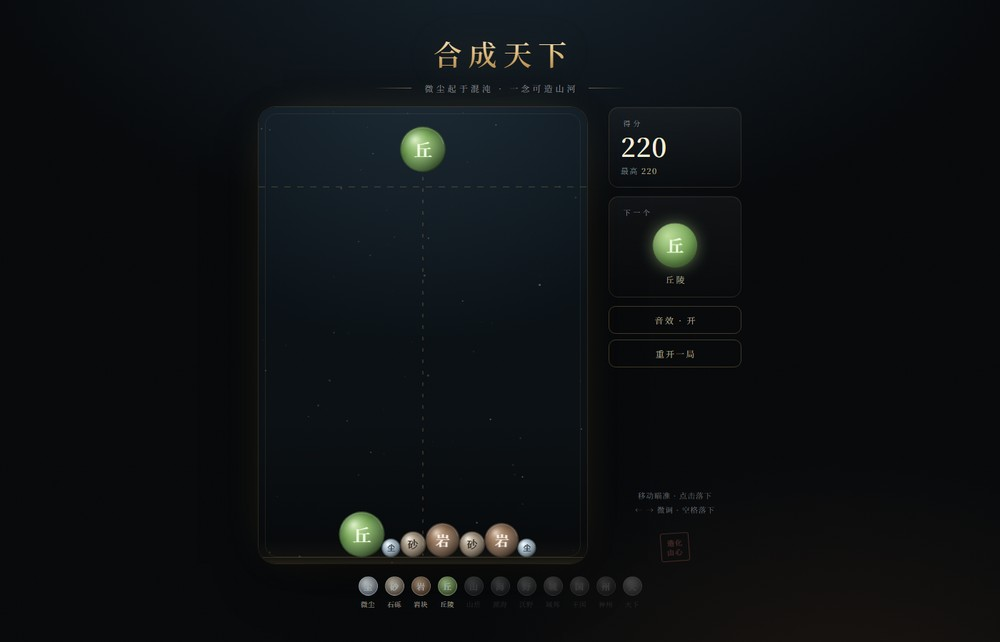

# 合成天下

> 微尘起于混沌 · 一念可造山河

一款以「造物」为题的网页合成小游戏。把两枚相同的造物叠在一起，它们便合为更高一阶的造物 —— 从一粒微尘开始，一路造到「天下」。

纯静态、零依赖、不需要构建，双击 `index.html` 就能玩。



## 玩法

- 移动鼠标 / 手指瞄准，点击（或按空格）落下造物。
- 两枚同阶造物相触即合，合出更高一阶并得分。
- 造物堆叠越过上方虚线、并持续约 1.7 秒，本局结束。
- 两枚「天下」相合 —— **天下大同**，额外 +5000。
- 键盘：`←` `→` 微调落点，`空格` 落下，`R` 重开一局。

## 造物阶次

| 阶 | 造物 | 字 | 二者相合所得（分） |
| -- | ---- | -- | ------------------ |
| 0  | 微尘 | 尘 | 10 |
| 1  | 石砾 | 砂 | 30 |
| 2  | 岩块 | 岩 | 60 |
| 3  | 丘陵 | 丘 | 100 |
| 4  | 山岳 | 山 | 150 |
| 5  | 湖海 | 海 | 210 |
| 6  | 沃野 | 野 | 280 |
| 7  | 城邦 | 城 | 360 |
| 8  | 王国 | 国 | 450 |
| 9  | 神州 | 州 | 550 |
| 10 | 天下 | 天 | 660（再 +5000 天下大同） |

出生权重：微尘 30、石砾 26、岩块 20、丘陵 15、山岳 9。

## 特性

- **自研物理**：Canvas 圆形刚体，固定步长积分 + 位置修正 + 切向摩擦，堆叠稳定不抖。
- **手绘质感**：径向渐变球体、高光斑、外缘双描边，越高的造物越沉，金线器底与虚线警戒线。
- **即时反馈**：粒子迸散、扩散环、飘分、震屏、连续合成横幅。
- **无资源音频**：Web Audio 现场合成落子与合成音，音高随造物阶次上升。
- **存档**：造物图鉴与最高分写入 `localStorage`。
- **响应式**：宽屏为「左棋盘 + 右状态栏」，窄屏把状态栏提到棋盘上方，单手可玩；适配 `prefers-reduced-motion`。

## 运行

任选其一：

1. 直接用浏览器打开 `index.html`（`file://` 协议即可，无需服务器）。
2. 起一个静态服务器：

   ```bash
   python -m http.server 8000
   # 然后访问 http://localhost:8000
   ```

## 目录结构

```
.
├── index.html          页面骨架与三态遮罩
├── src/
│   ├── levels.js       造物等级表、出生权重、计分
│   ├── audio.js        Web Audio 合成音效
│   ├── physics.js      圆形刚体物理世界
│   ├── game.js         渲染、输入、计分、图鉴、局内状态
│   └── style.css       墨底金线样式与响应式布局
└── docs/preview.jpg    预览图
```

调试：给地址加上 `#debug` 会挂出 `window.__HT`（`state` / `world` / `startGame` / `drop` / `addBall`），便于在控制台试验。

## 许可

本项目为个人作品，未附带开源许可证。
