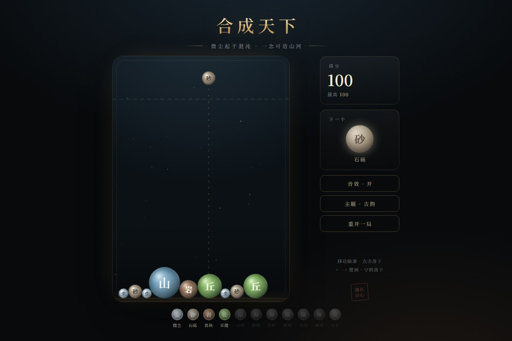

# 合成天下

> 微尘起于混沌，一念可造山河

一款以「造物」为题的网页合成小游戏。把两枚相同的造物叠在一起，它们便合为更高一阶的造物 —— 从一粒微尘开始，一路造到「天下」。

纯静态、零依赖、不需要构建，双击 `index.html` 就能玩。

页面是一张案几：纸为底，漆盘为局，墨为字，朱为号。内置两套皮肤，点一下就能换 —— **槟榔**（默认，玩个谐音梗）与 **古韵**（造山河）。


## 玩法

- 移动鼠标 / 手指瞄准，点击（或按空格）落下造物。
- 两枚同阶造物相触即合，合出更高一阶并得分。
- **连锁**：1.6 秒内接连合成会累加倍率，最高 ×5，右侧（盘内右上角）有倍率与倒计时。
- **待用**：按 `H` 或点「待用」把当前造物存起来，再按一次换回来 —— 不必硬着头皮落一个不合手的。
- 右侧会预告接下来两枚造物，提前想好落点。
- **磁吸**（默认开）：一定范围内的两枚同阶造物会彼此吸近，落到旁边差一点也能合上；吸附时两者之间会浮起一缕金晕。右上角「磁吸」按钮可随时开关，选择会记住。
- 造物堆叠越过上方虚线并持续约 1.7 秒判负，越线时盘沿会报警、盘顶有红条显示剩余时间。
- 两枚顶阶造物相合 —— **大同**，额外 +5000。
- 键盘：`←` `→` 微调落点，`空格` 落下，`H` 待用，`R` 重开，`T` 换主题。

## 造物阶次

| 阶 | 造物 | 字 | 二者相合所得（分） |
| -- | ---- | -- | ------------------ |
| 0  | 微尘 | 尘 | 10 |
| 1  | 石砾 | 砂 | 30 |
| 2  | 岩块 | 岩 | 60 |
| 3  | 丘陵 | 丘 | 100 |
| 4  | 山岳 | 山 | 150 |
| 5  | 湖海 | 海 | 210 |
| 6  | 沃野 | 野 | 280 |
| 7  | 城邦 | 城 | 360 |
| 8  | 王国 | 国 | 450 |
| 9  | 神州 | 州 | 550 |
| 10 | 天下 | 天 | 660（再 +5000 天下大同） |

出生权重：微尘 30、石砾 26、岩块 20、丘陵 15、山岳 9。上表分数为连锁倍率 ×1 时的底分。

> 上表是「古韵」皮肤的叫法。计分与出生权重两套皮肤共用，只换名字与外观 —— 另一套见下面的「主题」。

## 主题

右上角「换主题」按钮（或按 `T`）在两套皮肤间切换，选择会记在 `localStorage`，下次打开还是那套。
两套主题的造物半径完全一致，所以**局中换皮不会打乱正在堆叠的球**，只换外观；最高分与图鉴各自独立存档。

首次打开默认是「和成天下」；想让「古韵」当默认，把 `src/themes.js` 里的 `SH.DEFAULT_THEME_ID` 改成 `'tianxia'` 就行。

**槟榔**（`hecheng`）—— 槟榔红配焦糖金，一粒青果嚼到龙腾盛世，纯属谐音梗（见顶部预览）：

| 阶 | 0 | 1 | 2 | 3 | 4 | 5 | 6 | 7 | 8 | 9 | 10 |
| -- | - | - | - | - | - | - | - | - | - | - | -- |
| 造物 | 青果 | 烟果 | 果片 | 点卤 | 三十元装 | 五十元装 | 百元装 | 二百元装 | 门店礼盒 | 1000 果 | 龙腾盛世 |
| 字 | 青 | 烟 | 片 | 卤 | 三 | 五 | 百 | 二 | 礼 | 千 | 龙 |

> 本主题仅为谐音玩梗。**槟榔是一级致癌物，嚼槟榔有害健康。**

**古韵**（`tianxia`）—— 墨底金线，微尘 → 天下：



| 阶 | 0 | 1 | 2 | 3 | 4 | 5 | 6 | 7 | 8 | 9 | 10 |
| -- | - | - | - | - | - | - | - | - | - | - | -- |
| 造物 | 微尘 | 石砾 | 岩块 | 丘陵 | 山岳 | 湖海 | 沃野 | 城邦 | 王国 | 神州 | 天下 |
| 字 | 尘 | 砂 | 岩 | 丘 | 山 | 海 | 野 | 城 | 国 | 州 | 天 |

## 特性

- **自研物理**：Canvas 圆形刚体，固定步长积分 + 位置修正 + 切向摩擦，堆叠稳定不抖。
- **看得懂的球**：径向渐变 + 高光斑 + 外缘双描边，轮缘刻记数量随阶次递增，不靠颜色也能读数。
- **连锁有反馈**：倍率、倒计时条、飘分、震屏、连续合成横幅；音高随阶次与连锁一起上行。
- **判断有依据**：两枚预告、待用槽、地面落点记号、越线红条与盘沿报警。
- **无资源音频**：Web Audio 现场合成落子与合成音，仓库里没有一个音频文件。
- **存档**：造物图鉴与最高分按主题分别写入 `localStorage`。
- **双主题**：一套逻辑、两套皮肤（等级表 / 配色 / 字形 / 文案全在 `src/themes.js` 里），局中可换。
- **磁吸**：同级球在射程内互相拉近（`src/physics.js` 的 `_pull`，范围与速度见顶部常量），开关即时生效。
- **响应式**：宽屏三栏（得分与阶次 · 漆盘 · 预告与待用），窄屏收成上下结构；适配 `prefers-reduced-motion`。
- **随屏幕自适应**：漆盘不设像素上限，随窗口宽度与高度铺开；逻辑画布宽度也跟着变（400–1280），所以屏幕越大，盘上能铺开的地方越多、球相对越小。

## 运行

任选其一：

1. 直接用浏览器打开 `index.html`（`file://` 协议即可，无需服务器）。
2. 起一个静态服务器：

   ```bash
   python -m http.server 8000
   # 然后访问 http://localhost:8000
   ```

## 目录结构

```
.
├── index.html          页面骨架与三态遮罩
├── src/
│   ├── themes.js       两套主题：等级表、配色、字形、文案
│   ├── levels.js       造物等级表、出生权重、计分
│   ├── audio.js        Web Audio 合成音效
│   ├── physics.js      圆形刚体物理世界
│   ├── game.js         渲染、输入、连锁、待用、图鉴、局内状态
│   └── style.css       纸案与漆盘的视觉系统、双主题与响应式
└── docs/               预览图
```

调试：给地址加上 `#debug` 会挂出 `window.__HT`（`state` / `world` / `theme` / `startGame` / `drop` / `toggleHold` / `addBall` / `applyTheme` / `toggleTheme` / `toggleMagnet` / `magnet` / `size`），便于在控制台试验。

## 许可

本项目为个人作品，未附带开源许可证。
